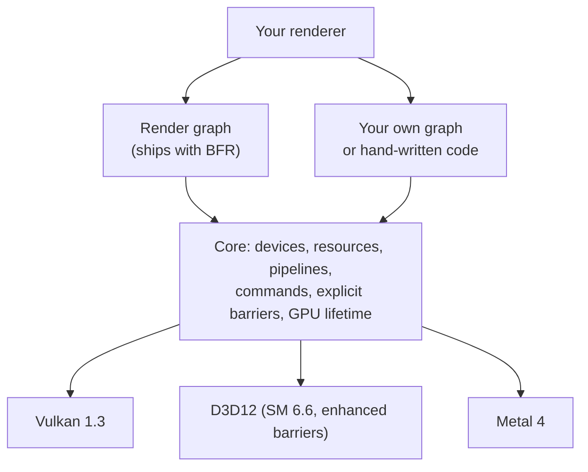
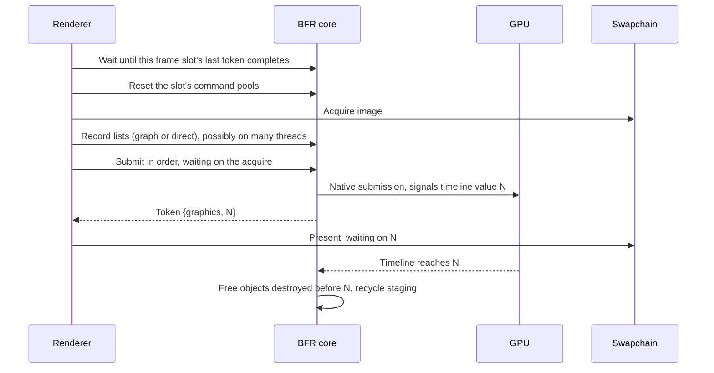

# How BFR works

A walkthrough of the current core design in [`design.md`](design.md): what
the pieces are, how a program uses them, and what happens underneath.
Everything here is provisional and changes when the design does. Code
sketches are illustrative; no names or signatures have been designed yet.

## The pieces

BFR is one library with two layers over three backends.



- **The core** turns your calls into native GPU work. It does what you say
  and nothing more: barriers are yours to state, order is yours to choose.
  It does own one thing for you: no GPU memory is freed while the GPU might
  still use it.
- **The render graph** is the normal way to build a frame. You describe
  passes and what each reads and writes; it orders them, places barriers and
  manages temporary textures. It is built only on the public core API, so
  anything it does, your own code can do too.
- **Backends** implement only the core. They never see the graph.

## Starting up

1. **Create an instance**, choosing a backend (Vulkan, D3D12 or Metal),
   validation settings and a message callback. Several instances, even of
   different backends, can live in one process.
2. **List adapters.** Each is a plain description: name, vendor, limits,
   optional features. Nothing is opened yet.
3. **Create a device** from one adapter, naming the queues and optional
   features you want (ray queries, mesh shaders). If the adapter misses the
   floor (bindless, dynamic rendering, timelines, enhanced barriers on D3D12)
   creation fails with a reason.
4. **Create a swapchain** per window from a native window handle and the
   queue that presents. Tools can have as many as they like.

The instance, device and command lists are pointers. Everything else comes
back as a small integer handle (slot, generation, type). Handles belong to
one device, and every call names the device, so a stale or wrong-type handle
is caught rather than dereferenced.

## Making things

**Buffers and textures** are created from descriptions (size, format,
usage). By default BFR places them in memory through its internal allocator.
For control over memory, create a **heap** and place resources in it; the
graph uses this to let short-lived textures share memory.

**Views** are how shaders see resources. Creating a texture or buffer view
gives it a slot in the device's bindless table and returns that slot's index.
Samplers get a slot in a separate sampler table (up to 2048, a D3D12 limit).

**Pipelines** (graphics, mesh, compute) are built from per-backend shader
bytecode, fixed state and attachment formats. There are no render pass
objects and no per-pipeline layouts. Creation is asynchronous: a pipeline
is *pending*, *ready* or *failed*. Loading screens wait; during play the
renderer picks a fallback. Using a pipeline that is not ready is an error.

**Uploads** go through a core helper that stages data, records the copy and
its barriers, and returns a completion token. **Readback** works the same
way in reverse; the data is available once the token completes. Waiting is
always an explicit call.

## How shaders see resources

Every pipeline shares one layout:

- a bindless table of texture and buffer views,
- a sampler table,
- a push-constant block of at most 128 bytes.

A draw passes indices, not bindings. The shader reads them from push
constants and indexes the tables:

```hlsl
// Illustrative.
struct DrawConstants { uint vertices; uint transforms; uint material; uint albedo; };
[[vk::push_constant]] ConstantBuffer<DrawConstants> pc;

VSOut main(uint vid : SV_VertexID, uint iid : SV_InstanceID)
{
    StructuredBuffer<Vertex> verts = ResourceDescriptorHeap[pc.vertices];
    Vertex v = verts[vid];  // vertex pulling: no vertex buffers or input layouts
    ...
}
```

Buffers are reached by index rather than GPU pointer because HLSL on D3D12
has no pointer dereference. GPU addresses appear only where native APIs
require them: indirect arguments and ray-tracing build inputs.

Because shaders reach resources the API never sees draw by draw, BFR keeps
every live bindless resource *resident* (Metal 4 requires this explicitly).

## Recording work

Each recording thread owns a **command pool** for each frame in flight. From
it come **command lists**, recorded by that thread only. A pool is reset once
the GPU has finished the frame that used it.

A list holds:

- **Barriers**, stated explicitly and batched: per resource (with a
  subresource range) or global, each giving the stage and access before and
  after, plus the texture layout.
- **Rendering scopes** with their attachments and load and store actions.
  Tile-based mobile GPUs depend on these, so they are always explicit.
- Draws (direct, indexed, indirect, indirect count), mesh dispatches,
  compute dispatches, copies, clears, acceleration-structure builds,
  push constants, pipeline binds, viewport and scissor, queries, timestamps
  and debug markers.

```cpp
// Illustrative. A direct-path scene pass without the graph.
CommandList cl = device.begin(pool);
cl.barrier({ .texture = scene_color,
             .before  = { .stage = none,         .access = none,        .layout = undefined },
             .after   = { .stage = color_output, .access = color_write, .layout = color_attachment } });
cl.begin_rendering({ .color = { { scene_color, Load::clear, Store::store } },
                     .depth = { depth, Load::clear, Store::discard } });
cl.bind(scene_pipeline);
cl.push_constants(DrawConstants{ mesh_vertices, transforms, material, albedo });
cl.draw_indexed_indirect(draw_args, count_buffer, max_draws);
cl.end_rendering();
device.end(cl);
```

Lists recorded on different threads run in the order you hand them to
`submit`. The order threads finished recording means nothing.

## Submitting and knowing when work is done

Each queue has a **timeline**: a counter the GPU advances as work finishes.
A **completion token** is `{queue, value}`.

- `submit` takes lists, tokens to wait on and returns the token it signals.
- Other queues can wait on that token; the CPU can poll it or wait on it.
- Binary semaphores exist only inside the swapchain, hidden from you.

```cpp
// Illustrative.
SwapchainImage img = device.acquire(swapchain);           // texture + hidden wait
Token done = device.submit(graphics, { cl, ui_cl }, { .wait = { img.ready } });
device.present(swapchain, img, done);
```

## A frame, end to end



Frames in flight overlap: the CPU waits only when it comes back to a slot
whose previous work is still running.

## Using the graph, or your own

With BFR's graph you import persistent resources (including the swapchain
image), describe temporary textures and add passes with their reads and
writes. The graph orders passes, emits the barriers, pools temporary
textures and calls your pass callbacks to record. It submits through the
same core calls you would. What the graph does and does not do in its first
version is still open.

With your own graph, or none, you call the core directly and state barriers
yourself.

Either way, one rule holds: **one authority per resource at a time.** A
resource the graph did not create is imported with its current state and
exported with its final state, so the graph, your code and native interop
can hand resources between each other safely.

## Lifetime

- `destroy(handle)` makes the handle invalid at once, but the memory is
  freed only after every queue passes the work submitted before the call.
  You never track that yourself.
- Destroying something an unsubmitted command list still uses is an error;
  validation reports it.
- Destroying a view frees its bindless slot under the same rule, and updates
  residency.

## Threading

| Operation | Rule |
|---|---|
| Create or destroy objects on a device | Any thread, concurrently |
| Record a command list | One thread at a time |
| Submit to a queue | One thread at a time per queue; different queues concurrently |
| Acquire or present on a swapchain | One thread at a time per swapchain |

## When things go wrong

- Creation returns either the handle or an error with a reason.
- Recording calls return nothing. Misuse is caught by validation, which
  reports through your message callback.
- Window resize and surface loss come back as results from acquire and
  present, not as fatal errors.
- Device loss is sticky: every later call reports it, and your callback
  fires once.

## How the backends map

| BFR concept | Vulkan 1.3 | D3D12 | Metal 4 |
|---|---|---|---|
| Timeline | Timeline semaphore | Fence | Shared event |
| Barrier | Synchronization 2 | Enhanced barriers | Encoder barriers |
| Bindless table | One descriptor set, descriptor indexing | Shader-visible descriptor heap (SM 6.6) | Argument buffer |
| Push constants | Push constants | Root constants | Copied into the command pool's upload ring; its GPU address bound in the argument table per draw |
| Rendering scope | Dynamic rendering | Render passes | Render command encoder |
| Command pool | Command pool | Command allocator | Command allocator |
| Heap | Device memory | Heap | Heap |
| Residency | Not needed | Resident by default | Residency set |
| Swapchain | Swapchain | DXGI swapchain | Metal layer drawables |
| Inline ray tracing | Ray query | Inline ray tracing (DXR 1.1) | Intersector in any shader |

## Still open

- Mobile descriptor limits, which size the bindless tables.
- Render graph scope: which features ship first, rebuilt per frame or
  cached, how callbacks record.
- Shader contract: source language and compiler, bytecode packaging.
- Ray-tracing pipelines and how they map to Metal.
- Host hooks: logging, allocators, pipeline cache, imports, diagnostics.
- Repo, build, tests, first backend, CI.
